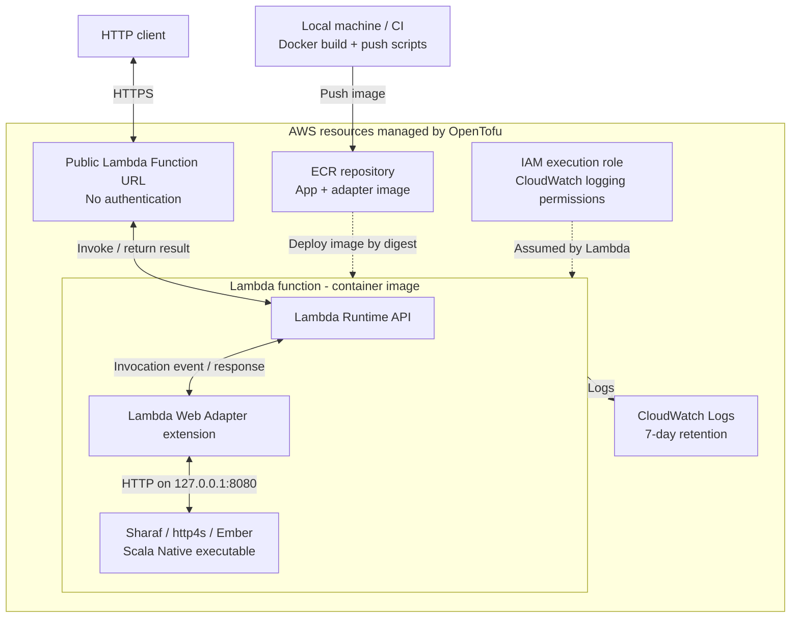

# sharaf-aws-lambda-starter

A minimal [Sharaf](https://sake92.github.io/sharaf/) (Scala 3) HTTP app running on **AWS Lambda** through the
[AWS Lambda Web Adapter](https://github.com/aws/aws-lambda-web-adapter) (LWA), deployed with **OpenTofu**, with an
automated integration test on [Floci](https://github.com/floci-io/floci) (a local AWS emulator) via
[Testcontainers](https://testcontainers.com/modules/floci/).

The app is an ordinary http4s/Ember-based Sharaf server compiled with Scala Native.
Deployment to AWS with OpenTofu has been manually verified.

## Deployment architecture



OpenTofu creates the ECR repository, execution role and log group first. The scripts build and push the image;
a second apply uses its digest to create the Lambda function and Function URL. ECR stores the deployment image;
requests go through the Function URL to the running Lambda environment.

## Prerequisites

JDK 21, [sbt](https://www.scala-sbt.org/download/) (the build pins sbt 2.0.12), and a native toolchain
(Clang plus `libgc`, `libunwind`, zlib, and OpenSSL development packages) for local linking;
libcurl and libidn2 development packages for the sttp native route tests; Docker for the image and Floci test;
[OpenTofu](https://opentofu.org/docs/intro/install/) >= 1.13.2 and AWS CLI v2 for deploying.
Deploying needs an AWS account and credentials; the Floci test needs neither.

## Run and test locally

Start the app:

```bash
sbt app/run
```

In another terminal, test the endpoints:

```bash
curl localhost:8080/health
# {"status":"ok"}

curl -X POST localhost:8080/hello -d '{"name":"Ana"}'
# {"greeting":"Hello, Ana!"}

curl -X POST 'localhost:8080/hello?greeting=Hi' -d '{"name":"Ana"}'
# {"greeting":"Hi, Ana!"}
```

Run the route tests:

```bash
sbt app/test
```

Run the end-to-end integration test with Floci (requires Docker):

```bash
sbt integrationTest/test
```

## Deploy to AWS

> **The Function URL is public and unauthenticated** (`authorization_type = "NONE"`): anyone on the internet can call
> it and you pay for it. Demo only; destroy it when done. Since Oct 2025 a public URL needs both
> `lambda:InvokeFunctionUrl` (auth type NONE) and `lambda:InvokeFunction` (invoked via Function URL) permissions;
> both are in `terraform/main.tf`.

The Lambda needs an image that must already exist in ECR, hence two applies:

```bash
export AWS_REGION=eu-west-1 TF_VAR_region=eu-west-1    # TF_VAR_name_prefix=... to change the default "sharaf-demo"
tofu -chdir=terraform init
tofu -chdir=terraform apply                       # 1) ECR repository, IAM role, log group
scripts/build-image.sh
DIGEST=$(scripts/push-image.sh "$(tofu -chdir=terraform output -raw ecr_repository_url)")
tofu -chdir=terraform apply -var "image_digest=$DIGEST"   # 2) Lambda + Function URL
```

The function is deployed from the immutable digest (`repo@sha256:...`); the ECR repo is tag-immutable, so
`push-image.sh` uses a fresh timestamp tag each time.

Call it:

```bash
URL=$(tofu -chdir=terraform output -raw function_url)
curl "${URL}health"
curl -X POST "${URL}hello" -d '{"name":"Ana"}'
```

**Update the image:** change the code, then repeat `build-image.sh`, `push-image.sh`, and
`tofu -chdir=terraform apply -var "image_digest=$DIGEST"`.

**Remove everything** (Lambda, URL, role, log group, ECR repository *including its images*; the repo uses `force_delete`):

```bash
tofu -chdir=terraform destroy
```
Local images/tags can be removed with `docker rmi`.

## How the adapter works

The AWS Lambda Web Adapter translates Lambda invocation events into HTTP requests to the ordinary Sharaf server and converts its HTTP responses back into Lambda responses.
The adapter and the Scala Native app are packaged together in the deployment Docker image.
