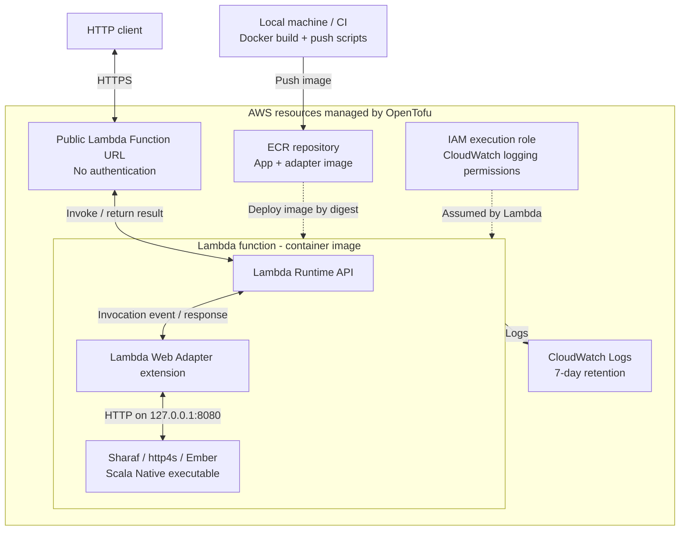

# sharaf-aws-lambda-starter

A minimal [Sharaf](https://sake92.github.io/sharaf/) (Scala 3) HTTP app running on **AWS Lambda** through the
[AWS Lambda Web Adapter](https://github.com/aws/aws-lambda-web-adapter) (LWA), deployed with **OpenTofu**, with an
automated integration test on [Floci](https://github.com/floci-io/floci) (a local AWS emulator) via
[Testcontainers](https://testcontainers.com/modules/floci/).

There is no custom Lambda handler and no Lambda SDK: the app is an ordinary http4s/Ember-based Sharaf server,
compiled to a Scala Native Linux executable.

| Path | What |
|---|---|
| `app/` | Scala Native Sharaf app and native route tests: `GET /health`, `POST /hello` |
| `build.sbt`, `project/` | sbt build, dependency versions, Scala Native and formatting plugins |
| `Dockerfile` | Builds the app and adds LWA as a Lambda extension |
| `terraform/` | ECR, IAM role, Lambda (container image), public Function URL |
| `scripts/build-image.sh`, `scripts/push-image.sh` | Docker build / ECR push (kept out of OpenTofu) |
| `integration-test/` | Floci + Testcontainers integration test (`sbt integrationTest/test`) |

## Deployment architecture



OpenTofu creates the ECR repository, execution role and log group first. The scripts build and push the image;
a second apply uses its digest to create the Lambda function and Function URL. ECR stores the deployment image;
requests go through the Function URL to the running Lambda environment.

Inside Lambda, the adapter translates invocation events into local HTTP requests to Sharaf and translates responses
back. Both processes run from the same image. See [how the adapter works](#how-the-adapter-works) below.

## Prerequisites

JDK 21, [sbt](https://www.scala-sbt.org/download/) (the build pins sbt 2.0.12), and a native toolchain
(Clang plus `libgc`, `libunwind`, zlib, and OpenSSL development packages) for local linking; Docker for the image and Floci test;
[OpenTofu](https://opentofu.org/docs/intro/install/) >= 1.13.2 and AWS CLI v2 for deploying.
Deploying needs an AWS account and credentials; the Floci test needs neither.

## Run locally (no AWS)

```bash
sbt app/run                              # runs the native executable on 0.0.0.0:8080; override with PORT=9000
curl localhost:8080/health                # {"status":"ok"}
curl -X POST localhost:8080/hello -d '{"name":"Ana"}'                 # {"greeting":"Hello, Ana!"}
curl -X POST 'localhost:8080/hello?greeting=Hi' -d '{"name":"Ana"}'   # {"greeting":"Hi, Ana!"}
```

Route tests: `sbt app/test` (Scala Native tests run in the `app/` module; Docker is only needed for the separate integration tests).
Check formatting: `sbt 'app/scalafmtCheckAll; scalafmtCheckAll; scalafmtSbtCheck; integrationTest/scalafmtCheckAll'`.
Format sources and build files: `sbt 'app/scalafmtAll; scalafmtAll; scalafmtSbt; integrationTest/scalafmtAll'`.
(OpenTofu: `tofu -chdir=terraform fmt -check`.)

Build a release executable for the current host: `sbt app/nativeLink` (writes `app/target/native/sharaf-lambda`; on macOS this is a macOS executable). The deployment image builds the Linux/amd64 executable in Docker with `scripts/build-image.sh`.

The same image runs outside Lambda too (the adapter does nothing without the Lambda runtime API):
`scripts/build-image.sh && docker run --rm -p 8080:8080 sharaf-lambda:local`.

## Floci integration test

```bash
sbt integrationTest/test
```

`integration-test/FlociLambdaSuite` uses the [Testcontainers Floci module](https://github.com/floci-io/testcontainers-floci)
(`io.floci:testcontainers-floci-aws`, with Floci pinned to `floci/floci:2.3.0`). It:

1. runs `scripts/build-image.sh` (the same image build as for AWS), tagging it with an AWS-shaped ECR URI;
2. starts Floci (Docker socket + dedicated network are handled by the module);
3. creates a container-image Lambda and a Function URL with the AWS SDK (Floci runs the locally built image as-is, so no
   registry push is needed);
4. sends real HTTP requests to the Function URL and asserts status codes and JSON for `/health` and `/hello`, that the
   `?greeting=` query parameter reaches Sharaf, that an invalid body yields `400` and an unknown route `404`.

Testcontainers removes the containers and network, also on failure; Floci logs are printed when an assertion fails.
The test only talks to the Testcontainers-managed Floci endpoint with its dummy credentials, never to real AWS.

Path under test: `HTTP client -> Floci Function URL -> Lambda Web Adapter (extension in the Lambda container) -> Sharaf`.

OpenTofu is deliberately **not** exercised against Floci (an emulator says little about real IAM/permission behaviour);
CI only runs `tofu fmt` and `validate`.

Floci notes: it starts `/opt/extensions/*` itself, so LWA works unchanged. It does not enforce IAM or the Function URL
permissions, and Function URLs are routed by Host header, so the test keeps the generated `*.lambda-url.<region>.localhost`
host name and swaps in the mapped container port.

## Deploy to AWS

For an existing Terraform deployment, back up the state before switching, then run `tofu -chdir=terraform init`
and `tofu -chdir=terraform plan`. Resolve any unexpected changes before applying; see the
[OpenTofu migration guide](https://opentofu.org/docs/intro/migration/migration-guide/).

> **The Function URL is public and unauthenticated** (`authorization_type = "NONE"`): anyone on the internet can call
> it and you pay for it. Demo only; destroy it when done. Since Oct 2025 a public URL needs both
> `lambda:InvokeFunctionUrl` (auth type NONE) and `lambda:InvokeFunction` (invoked via Function URL) permissions;
> both are in `terraform/main.tf`.

The Lambda needs an image that must already exist in ECR, hence two applies:

```bash
export AWS_REGION=eu-west-1 TF_VAR_region=eu-west-1    # TF_VAR_name_prefix=... to change the default "sharaf-demo"
tofu -chdir=terraform init
tofu -chdir=terraform apply                       # 1) ECR repository, IAM role, log group
scripts/build-image.sh
DIGEST=$(scripts/push-image.sh "$(tofu -chdir=terraform output -raw ecr_repository_url)")
tofu -chdir=terraform apply -var "image_digest=$DIGEST"   # 2) Lambda + Function URL
```

The function is deployed from the immutable digest (`repo@sha256:...`); the ECR repo is tag-immutable, so
`push-image.sh` uses a fresh timestamp tag each time.

Call it:

```bash
URL=$(tofu -chdir=terraform output -raw function_url)
curl "${URL}health"
curl -X POST "${URL}hello" -d '{"name":"Ana"}'
```

**Update the image:** change the code, then repeat `build-image.sh`, `push-image.sh`, and
`tofu -chdir=terraform apply -var "image_digest=$DIGEST"`.

**Remove everything** (Lambda, URL, role, log group, ECR repository *including its images*; the repo uses `force_delete`):

```bash
tofu -chdir=terraform destroy
```
Local images/tags can be removed with `docker rmi`.

## How the adapter works

The adapter translates between Lambda's event protocol and the ordinary HTTP protocol that Sharaf speaks.

The Function URL turns an incoming HTTP request into a Lambda event containing the method, path, query string,
headers and body. LWA polls the Lambda Runtime API for that event, translates it into a local HTTP request, and
sends it to Sharaf. The response travels back through the same components: LWA converts Sharaf's HTTP status,
headers and body into a Lambda response, which the Function URL returns to the client. Port 8080 is internal;
the public endpoint is the Function URL.

At startup, Lambda starts LWA as an extension (`/opt/extensions/lambda-adapter`) alongside the native executable
(the image's `ENTRYPOINT`). Before accepting invocations, LWA waits until `GET /health` on port 8080 returns 2xx,
as configured in the `Dockerfile`. The server stays running to handle subsequent invocations in that execution
environment; it does not start again for each request.

Sharaf only handles ordinary HTTP requests, so its routes need no Lambda-specific code. See the
[upstream architecture guide](https://github.com/aws/aws-lambda-web-adapter/blob/main/docs/guide/src/reference/architecture.md)
for more detail.

## What is verified where

Verified by `sbt integrationTest/test`: the image builds and starts as a Lambda container image; LWA starts as an
extension, passes its readiness check and proxies events; Function URL requests reach Sharaf with method, path, query,
body and JSON responses intact.

**Not** verified (needs a real AWS account): applying the OpenTofu configuration and AWS accepting the IAM/permission setup
(the public URL really being callable without auth), ECR push/auth and image pull, real Lambda init timing/cold start
(native executable, 1024 MB, 30 s timeout are untuned), CloudWatch logging, and the exact real Function URL event.
