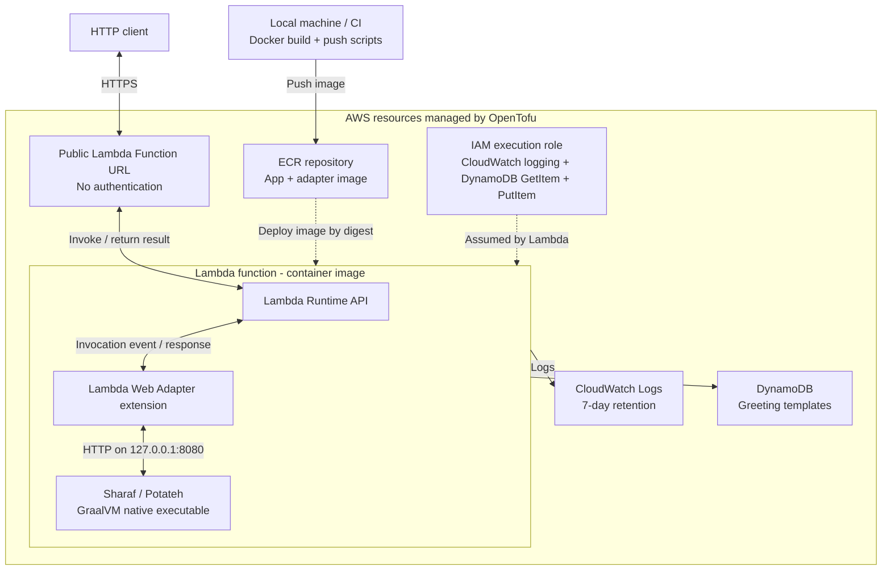

# sharaf-aws-lambda-starter

A minimal [Sharaf](https://sake92.github.io/sharaf/) (Scala 3) HTTP app running on **AWS Lambda** through the
[AWS Lambda Web Adapter](https://github.com/aws/aws-lambda-web-adapter) (LWA), deployed with **OpenTofu**, with an
automated integration test on [Floci](https://github.com/floci-io/floci) (a local AWS emulator) via
[Testcontainers](https://testcontainers.com/modules/floci/).

The app uses Sharaf's experimental Potateh adapter (`0.24.0`), compiled with GraalVM Native Image.
The Docker build uses a statically linked musl executable and an Alpine runtime image.
The previous http4s/Ember version was manually deployed to AWS with OpenTofu; this version needs a new AWS verification.

## Deployment architecture



OpenTofu creates the ECR repository, execution role, log group and DynamoDB table first. The scripts build and push the
image. A second apply uses its digest to create the Lambda function and Function URL. ECR stores the deployment image;
requests go through the Function URL to the running Lambda environment.

## Prerequisites

JDK 21 or later and [sbt](https://www.scala-sbt.org/download/) (the build pins sbt 2.0.12) for JVM development;
GraalVM 25 with `native-image` and a C toolchain for local native builds; Docker for the image and Floci test;
[OpenTofu](https://opentofu.org/docs/intro/install/) >= 1.13.2 and AWS CLI v2 for deploying.
Deploying needs an AWS account and credentials. The Floci test runs against a local emulator.

## Run and test locally

Start the app:

```bash
AWS_REGION=us-east-1 sbt app/run
```

In another terminal, test the endpoints:

```bash
curl localhost:8080/health
# {"status":"ok"}

curl -X POST localhost:8080/hello -d '{"name":"Ana"}'
# {"greeting":"Hello, Ana!"}

curl -X POST 'localhost:8080/hello?greeting=Hi' -d '{"name":"Ana"}'
# {"greeting":"Hi, Ana!"}
```

Run the route tests:

```bash
sbt app/testFull
```

Build the local executable with GraalVM on `PATH`:

```bash
sbt app/nativeImage
target/out/jvm/scala-3.9.0/sharaf-lambda/native-image/sharaf-lambda
```

Run the end-to-end integration test with Floci (requires Docker). The suite creates an empty table and
checks greeting creation, lookup and validation through the Function URL. This verifies the container and
HTTP integration locally. AWS deployment and cold-start behavior require checks on AWS.

The app uses the fixed DynamoDB table name `sharaf-demo-greetings`. For local DynamoDB requests, set
`AWS_ENDPOINT_URL_DYNAMODB` to your Floci endpoint and use dummy credentials. The Floci suite configures
these and creates the table automatically.

```bash
sbt integrationTest/testFull
```

## Deploy to AWS

> **The Function URL is public and unauthenticated** (`authorization_type = "NONE"`): anyone on the internet can call
> it, create public demo greetings, and incur charges on the deploying account. Destroy the demo when you are done.
> Since October 2025, a public URL needs both `lambda:InvokeFunctionUrl` (auth type NONE) and `lambda:InvokeFunction`
> (invoked via Function URL). Both permissions are in `terraform/main.tf`.

The Lambda needs an image that must already exist in ECR, hence two applies:

```bash
export AWS_REGION=eu-west-1 TF_VAR_region=eu-west-1    # TF_VAR_name_prefix=... to change the default "sharaf-demo"
tofu -chdir=terraform init
tofu -chdir=terraform apply                       # 1) ECR repository, IAM role, log group, DynamoDB table
scripts/build-image.sh
DIGEST=$(scripts/push-image.sh "$(tofu -chdir=terraform output -raw ecr_repository_url)")
tofu -chdir=terraform apply -var "image_digest=$DIGEST"   # 2) Lambda + Function URL
```

The function is deployed from the immutable digest (`repo@sha256:...`); the ECR repo is tag-immutable, so
`push-image.sh` uses a fresh timestamp tag each time.

Call the Function URL and create a greeting. Send non-blank text of up to 256 characters. The Lambda role can
read and write items in the greetings table.

```bash
URL=$(tofu -chdir=terraform output -raw function_url)
curl "${URL}health"
curl -X POST "${URL}hello" -d '{"name":"Ana"}'
curl -i -X POST "${URL}greetings" -H 'Content-Type: application/json' \
  -d '{"greeting":"Welcome from DynamoDB!"}'
# HTTP 201 Created with a generated id in the JSON body and a Location header

# Use the path returned in Location.
curl "${URL}greetings/<id>"
# {"greeting":"Welcome from DynamoDB!"}
curl -i "${URL}greetings/missing"
# HTTP 404
```

The fixed table name allows one starter deployment per AWS account and Region. If you deployed an earlier version
with a custom prefix, review the plan before applying. OpenTofu will replace the differently named table.
The DynamoDB Standard table provisions 1 read and 1 write capacity unit. AWS includes 25 of each
and 25 GB of storage in the DynamoDB Free Tier, shared per Region and payer account. Lambda, ECR,
and CloudWatch Logs have their own pricing. [DynamoDB pricing](https://aws.amazon.com/dynamodb/pricing/)

**Update the image:** change the code, then repeat `build-image.sh`, `push-image.sh`, and
`tofu -chdir=terraform apply -var "image_digest=$DIGEST"`.

**Remove everything** (Lambda, URL, role, log group, DynamoDB table and its data, ECR repository *including its images*; the repo uses `force_delete`):

```bash
tofu -chdir=terraform destroy
```
Local images/tags can be removed with `docker rmi`.

## How the adapter works

The AWS Lambda Web Adapter translates Lambda invocation events into HTTP requests to the ordinary Sharaf server and converts its HTTP responses back into Lambda responses.
The adapter and the GraalVM native app are packaged together in the deployment Docker image.
